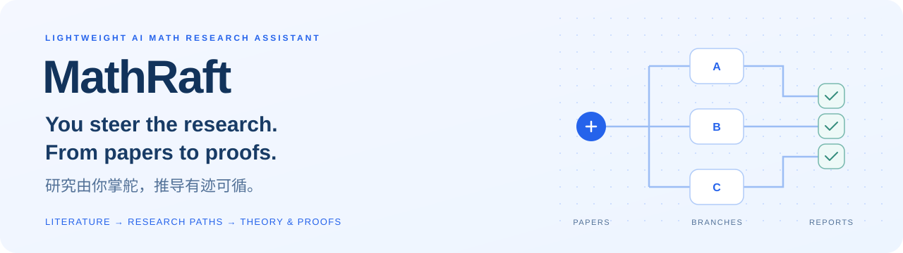
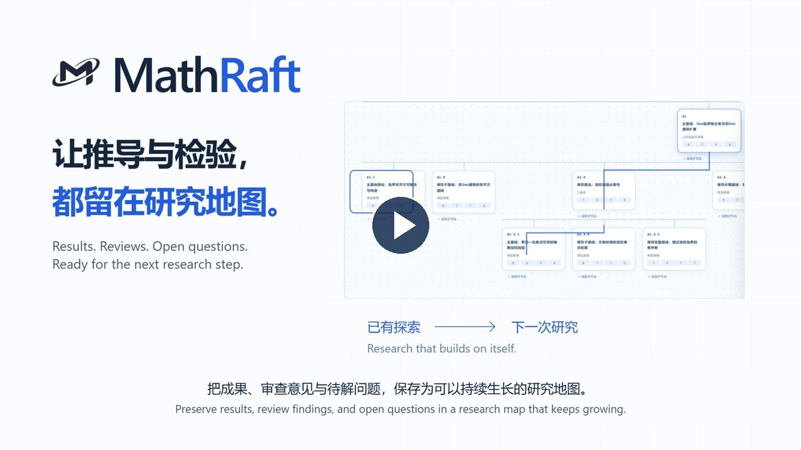
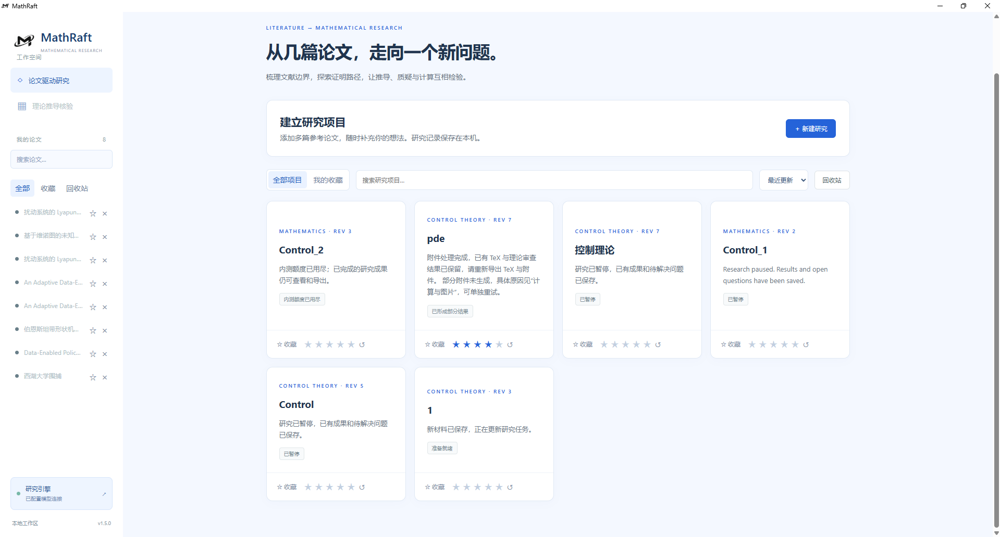
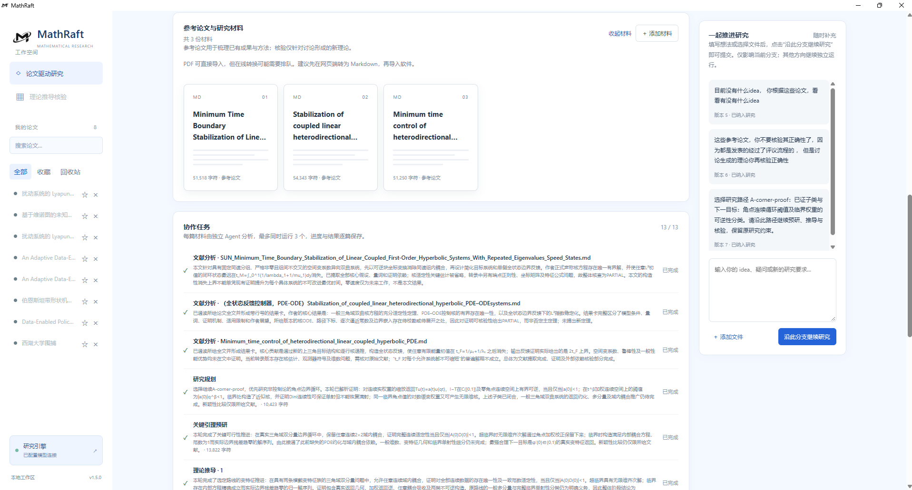
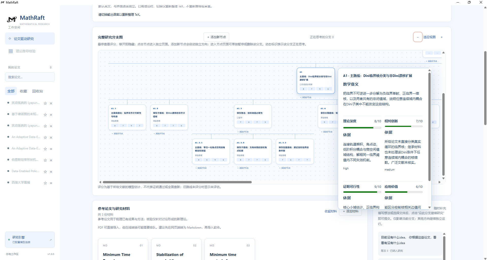
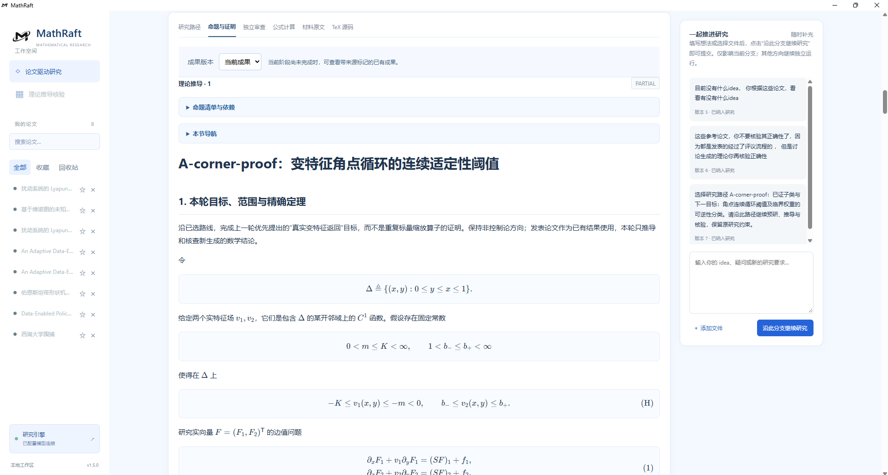

# MathRaft — Lightweight AI Math Research Assistant

  <strong>English</strong> · <a href="README.zh-CN.md">简体中文</a>

**Mathematical discovery, theorem derivation, and proof review.**

MathRaft is a **lightweight Windows desktop platform for AI-assisted mathematical research**, with an installer of approximately **50 MB** and **English and Chinese interfaces**. Bring related papers and your research ideas into a project, explore possible extensions, develop propositions and proofs, and inspect the results through independent proof reviews and Python formula checks. Export the resulting theory as **LaTeX / TeX source**.

Designed as an **AI co-mathematician workspace**, MathRaft keeps research directions, proof attempts, review reports, and your guidance connected in a persistent research map. It serves researchers in **mathematics, control theory, optimization, and partial differential equations (PDEs)**.

**中文简介：** MathRaft 是一个轻量化的 Windows AI 数学科研平台，安装包约 50 MB。将参考论文、研究选题、理论推导、证明核验与 LaTeX 输出连接起来，支持中英文界面，面向数学、控制理论、优化与偏微分方程等领域。[阅读完整中文介绍 →](README.zh-CN.md)

  <a href="https://github.com/SHENMR-web/MathRaft/releases/tag/v2.1.0">Download v2.1.0</a> ·
  <a href="#watch-the-preview">Watch the preview</a> ·
  <a href="#see-mathraft-in-action">Explore the workflow</a> ·
  <a href="#related-projects-in-ai-for-mathematics">Related projects</a> ·
  <a href="#availability">Downloads & community</a> ·
  <a href="https://github.com/SHENMR-web/MathRaft/issues/new?template=research-feedback.yml">Share your research needs</a>

  

## What can you research with MathRaft?

| Research task | How MathRaft helps |
| --- | --- |
| Find a research direction from papers | Analyze supplied literature, identify possible extensions, and organize candidate questions into research branches. |
| Develop a theorem and proof | Work from assumptions toward propositions, theoretical derivations, and explicit proof steps. |
| Review a new mathematical argument | Assign independent proof review and counterexample review, then compare the findings through cross-review. |
| Check formulas with Python | Inspect computational evidence for the expressions and cases covered by the generated checks. |
| Explore competing proof routes | Preserve alternative branches, compare their evaluations, and return to a promising direction later. |
| Prepare a research manuscript | Collect the derivation and review results and export editable LaTeX source. |

For example, a control researcher can start from related stability papers, explore a new set of assumptions, develop a candidate result, and review the proposed proof within one project. An optimization or PDE researcher can use the same workflow for a theoretical extension in their own field.

**Reference papers provide the starting material. Derivation and review focus on the new theory developed in your project.**

## Watch the preview

**Research map · Chapter 1 preview** — 32 seconds · 1080p · With background music.

[▶ Open the video](assets/videos/mathraft-research-map-preview-1080p.mp4) · [Download MP4](https://raw.githubusercontent.com/SHENMR-web/MathRaft/main/assets/videos/mathraft-research-map-preview-1080p.mp4)

## An AI co-mathematician guided by your judgment

MathRaft is built for researchers whose work centers on theoretical derivations and mathematical proofs. Start with papers from your field. MathRaft analyzes the literature, develops a research plan, and helps you explore possible directions.

Your research taste shapes the process. Add an idea, question an assumption, introduce another paper, or steer a promising branch further. MathRaft connects this collaboration to a visible research path, with derivations, independent reviews, computational checks, and detailed reports organized around each direction.

The workflow gives each direction a durable workspace: papers → research planning → theorem and proof development → independent review and Python checks → proof report and LaTeX export. Your guidance can feed back into the investigation as it develops.

**You steer the research. From papers to proofs.**

## See MathRaft in action

The five screenshots below illustrate the research workflow, including an example from PDE and control theory.

### 1. Give each research question a workspace

Create projects to keep related papers, research progress, and results together. Save ongoing work, find previous projects, and return to an investigation as it develops.

### 2. Start from papers. Shape the direction as you go.

Add relevant literature to a project. MathRaft analyzes the materials and forms a research plan. In the research panel, share ideas, ask questions, and add materials to guide the current branch according to your priorities.

### 3. Connect derivation, review, and computation

The research task view brings together theoretical derivation, independent proof review, independent counterexample review, Python formula checks, cross-review, and TeX preparation. Each task keeps its progress and results available for inspection.

Proof verification combines model-based mathematical review with computational evidence. Python checks cover the expressions and cases tested; the proof report keeps assumptions, proof dependencies, and unresolved steps available for your assessment.

### 4. Explore branches and compare their potential

A research question can lead to several possible paths. MathRaft can advance different research branches while you inspect their relationships, add directions, and decide which paths deserve more attention.

Branch evaluations provide scores and written reasoning across four dimensions:

| Dimension | Research question it helps you consider |
| --- | --- |
| Theoretical depth | How substantial is the mathematical direction? |
| Relative novelty | How does it extend the supplied literature? |
| Proof feasibility | How promising is the proposed proof route? |
| Application value | What could the result help explain or enable? |

These model-generated assessments help compare directions using the supplied literature and evaluation rationale.

### 5. Follow the path from a question to its proof report

Open a branch to examine its research path, propositions and proofs, independent reviews, formula calculations, source materials, and TeX source. Detailed reports preserve the argument, its dependencies, and the current result status, including partially completed work.

## Built for theory-driven research

MathRaft is designed for work in mathematics, control theory, optimization theory, PDE theory, and related fields where assumptions, derivations, and proof structure are central.

It supports a continuous research process: bring together relevant papers, frame a question, explore different approaches, inspect the arguments, and refine the next step with your own judgment.

## Related projects in AI for mathematics

AI for mathematics includes mathematical discovery, proof systems, and research environments. Useful projects to explore include:

| Project | Research focus |
| --- | --- |
| [Open Math OS](https://www.openmathmodel.org/) / [Open Math Harness](https://github.com/openmathmodel/open-math-harness) | Infrastructure for mathematical research; Open Math Harness is the open-source runtime of Open Math OS. |
| [Euler](https://github.com/canghaimeng/Euler) | Mathematical research with shared, structured state for coordinating exploration. |
| [MathRSI](https://github.com/lisresearchgroup/math-rsi) | Mathematical discovery and proof workflows, with research loops and verification tools. |

MathRaft focuses on a Windows desktop workflow that connects papers, researcher guidance, research branches, theoretical derivation, independent review, Python checks, and LaTeX output. The links above are pointers to independently developed projects.

## Availability

**MathRaft v2.1.0 is now available for Windows.** Download the installer (approximately 50 MB) and follow the user guide to install the software and start your first research project.

To start: install MathRaft, create a research project, add related papers and your question, and inspect the proposed research directions. Open a branch to guide the derivation, review its reports, and export the TeX source when ready.

| Download | Link |
| --- | --- |
| Windows installer (.exe, approximately 50 MB) | [Download from GitHub](https://github.com/SHENMR-web/MathRaft/releases/download/v2.1.0/MathRaft-2.1.0-Setup.exe) |
| User guide (Chinese PDF) | [Download the v2.1.0 user guide](https://github.com/SHENMR-web/MathRaft/releases/download/v2.1.0/MathRaft-V2.1.0-User-Guide.zh-CN.pdf) |
| Baidu Netdisk mirror | [Download MathRaft](https://pan.baidu.com/s/1LR85o4kUs5mgj7WWP3tGlg?pwd=qpnj) · Access code: **qpnj** |
| Quark Drive mirror | [Download MathRaft](https://pan.quark.cn/s/04584cad421f) |

**QQ group:** **849946426**

See the [v2.1.0 release](https://github.com/SHENMR-web/MathRaft/releases/tag/v2.1.0) for the release files.

- **Follow future releases:** star this repository and use **Watch → Custom → Releases** for release notifications.
- **Help shape MathRaft:** [share your research field, intended workflow, or feature ideas](https://github.com/SHENMR-web/MathRaft/issues/new?template=research-feedback.yml).
- **Read in Chinese:** [简体中文介绍](README.zh-CN.md).

---

  <strong>From a few papers to a new research question.</strong> 
  MathRaft · You steer the research. From papers to proofs.

