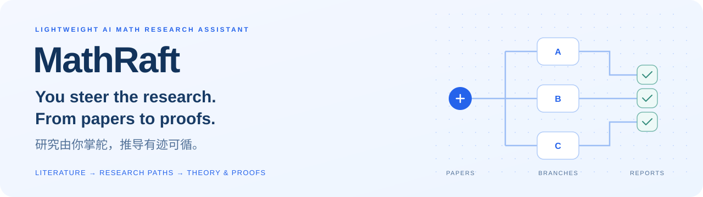
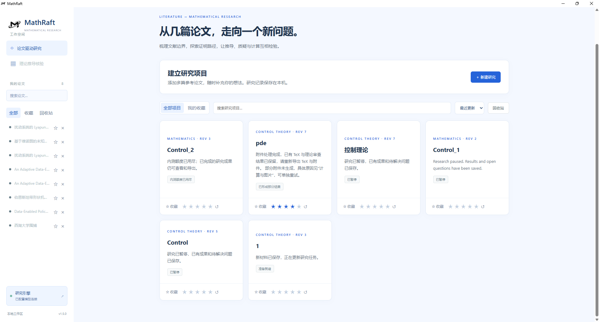
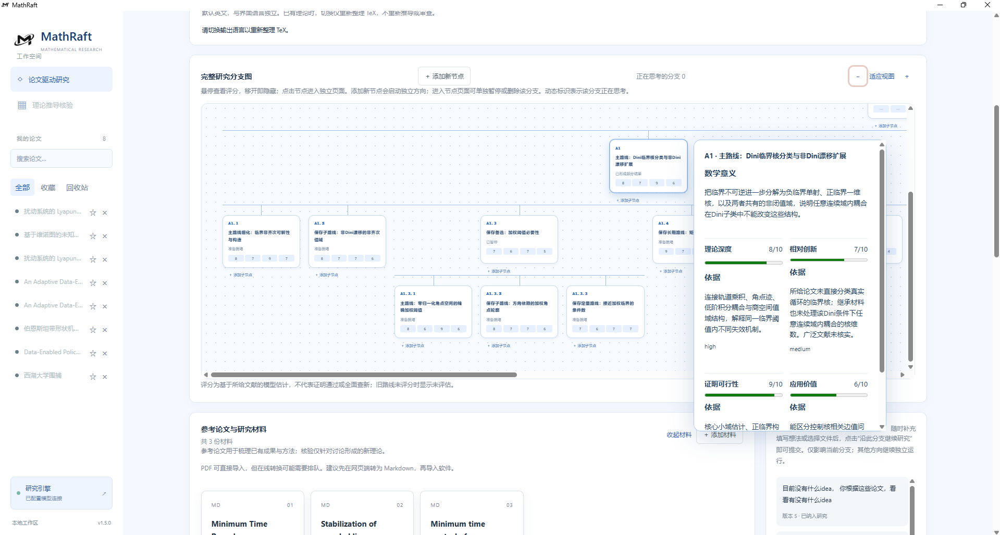

  

  <a href="README.md">English</a> · <strong>简体中文</strong>

  <strong>由多智能体协同驱动的数学科研平台。</strong> 
  从相关论文出发，与研究者一起形成研究规划、探索不同方向，沉淀可追溯的理论与证明报告。

  数学 · 控制理论 · 优化理论 · 偏微分方程

  <a href="#观看样片">观看样片</a> ·
  <a href="#跟随一个研究项目认识-mathraft">查看研究流程</a> ·
  <a href="#发布进展">发布进展</a> ·
  <a href="https://github.com/SHENMR-web/MathRaft/issues/new?template=research-feedback.yml">分享研究需求</a>

## 观看样片

**研究地图 · 首章样片** — 32 秒 · 1080p · 含背景音乐。

[▶ 打开视频](assets/videos/mathraft-research-map-preview-1080p.mp4) · [下载 MP4](https://raw.githubusercontent.com/SHENMR-web/MathRaft/main/assets/videos/mathraft-research-map-preview-1080p.mp4)

## 让你的研究判断贯穿整个过程

MathRaft 面向以理论推导与数学证明为核心的科研工作者。放入几篇相关领域的论文，多个智能体便可协同分析文献、形成研究规划，并与你一起推进可能的研究方向。

你的研究品味决定探索的方向。随时补充一个想法、追问某个假设、加入一篇新论文，或让一个有潜力的分支继续深入。MathRaft 将这些协作组织为清晰的研究路径，让推导、独立审查、计算核查与详细报告围绕每条路线展开。

**研究由你掌舵，探索协同推进。**

## 跟随一个研究项目认识 MathRaft

以下五张截图来自当前内测版本，展示了包括偏微分方程与控制理论示例在内的实际研究流程。

### 1. 为每个研究问题建立持续保存的空间

以项目组织相关论文、研究进展与已有成果。保存正在进行的工作，通过搜索与收藏找回项目，让一次探索可以随着问题的发展持续推进。

### 2. 从文献出发，按自己的研究品味调整方向

在项目中加入相关论文，驱动智能体分析材料并形成研究规划。通过研究交流面板补充想法、提出疑问或加入新材料，随时引导当前分支的研究重点。

### 3. 将推导、审查与计算连接起来

协作任务视图呈现理论推导、独立证明审查、独立反例审查、Python 公式核查、交叉复核与 TeX 整理等环节。各项任务的进度与结果持续保留，便于查看研究如何推进。

### 4. 沿不同分支探索，比较每条路线的潜力

一个问题可以展开为多条研究路径。MathRaft 支持多个智能体自主推进不同分支；研究者可以查看分支关系、增加方向，并决定哪些路线值得继续深入。

分支评估提供四个维度的评分与文字依据：

| 评估维度 | 帮助思考的问题 |
| --- | --- |
| 理论深度 | 这个方向在数学上有多大的研究空间？ |
| 相对创新 | 相对于所提供的文献，可能推进到哪里？ |
| 证明可行性 | 拟采用的证明路线是否值得继续尝试？ |
| 应用价值 | 相关结果可能解释或解决哪些问题？ |

这些评估由模型结合所提供的文献生成，研究者可以结合评价依据比较不同方向。

### 5. 从研究问题追溯到证明报告

进入具体分支，可以查看研究路径、命题与证明、独立审查、公式计算、材料原文与 TeX 源码。详细报告保留论证过程、命题依赖与当前成果状态，也支持查看尚在推进中的阶段性结果。

## 面向以理论为核心的科研工作

MathRaft 面向数学、控制理论、优化理论、偏微分方程理论及相关领域，服务于重视假设、推导与证明结构的研究工作。

从组织相关论文、形成研究问题，到探索不同方法、审视论证并确定下一步，研究者与多个智能体可以在同一条持续演进的研究路径中协作。

## 发布进展

**MathRaft 目前正在内测。** 本仓库先行展示产品介绍与当前研究流程。内测完成后，软件将加入本仓库，并在这里公布发布信息与使用说明。

- **关注后续发布：** 为仓库点亮 Star，并通过 **Watch → Custom → Releases** 订阅未来的版本发布。
- **参与产品交流：** [分享你的研究领域、使用场景或功能建议](https://github.com/SHENMR-web/MathRaft/issues/new?template=research-feedback.yml)。
- **阅读英文介绍：** [English](README.md)。

---

  <strong>从几篇论文，走向一个新问题。</strong> 
  MathRaft · 研究由你掌舵，探索协同推进。

