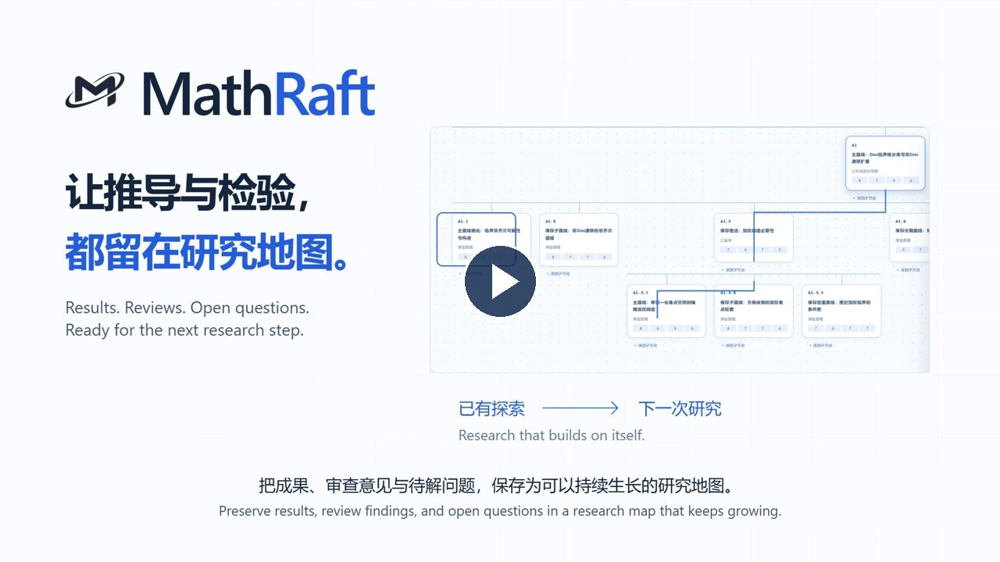
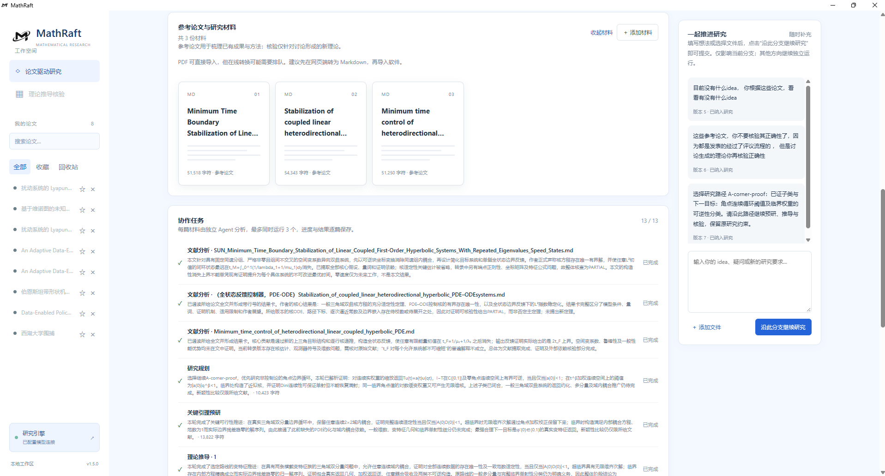
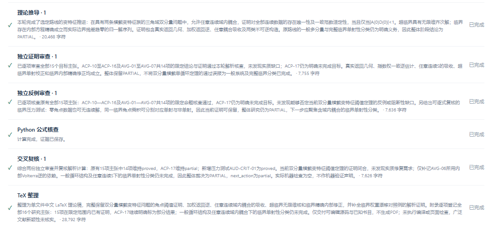
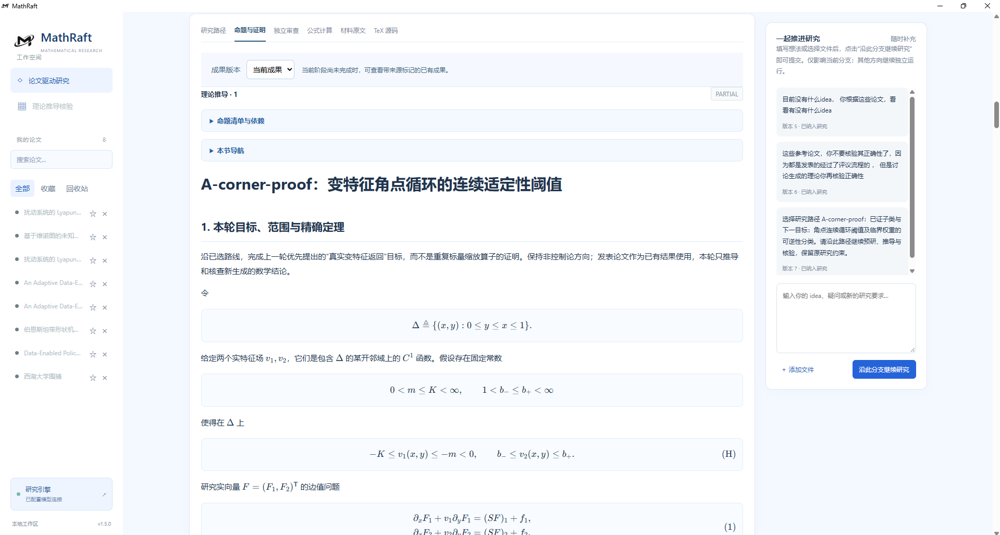

# MathRaft — 轻量化 AI 数学科研助手

  <a href="README.md">English</a> · <strong>简体中文</strong>

**连接数学研究选题、定理推导与证明核验。**

MathRaft 是面向 **AI 辅助数学研究（AI-assisted mathematical research）** 的轻量化 Windows 桌面平台，安装包约 **50 MB**，支持中英文界面。将相关论文与研究想法放入项目，探索可能的理论拓展，推导命题与证明，再通过独立证明审查和 Python 公式核查审视结果，最后导出可编辑的 **LaTeX / TeX 源码**。

作为 **AI 数学研究伙伴（AI co-mathematician）**，MathRaft 将研究方向、证明尝试、审查报告与研究者的引导组织在一张持续保存的研究地图中，面向 **数学、控制理论、优化理论、偏微分方程（PDE）** 及相关理论研究领域。

  <a href="https://github.com/SHENMR-web/MathRaft/releases/tag/v2.1.0">下载 v2.1.0</a> ·
  <a href="#观看样片">观看样片</a> ·
  <a href="#跟随一个研究项目认识-mathraft">查看研究流程</a> ·
  <a href="#ai-数学研究相关项目">相关项目</a> ·
  <a href="#下载与交流">下载与交流</a> ·
  <a href="https://github.com/SHENMR-web/MathRaft/issues/new?template=research-feedback.yml">分享研究需求</a>

  

## MathRaft 能协助哪些研究任务？

| 研究任务 | MathRaft 的工作方式 |
| --- | --- |
| 从论文中形成研究选题 | 分析所提供的文献，寻找可能的拓展，并将候选问题组织为研究分支。 |
| 推导定理与证明 | 从假设出发，逐步建立命题、理论推导与明确的证明步骤。 |
| 核验新生成的数学论证 | 分配独立证明审查与反例审查，再通过交叉复核汇总发现。 |
| 使用 Python 核查公式 | 为脚本所覆盖的表达式和情形提供可查看的计算核查依据。 |
| 比较与继续不同证明路线 | 保存备选分支、查看评估结果，之后仍可回到有潜力的方向继续研究。 |
| 整理研究论文初稿 | 汇总推导与审查结果，导出可继续编辑的 LaTeX 源码。 |

例如，控制理论研究者可以从几篇稳定性相关论文出发，探索一组新的假设，推导候选结论，并在同一项目中审查证明；优化或 PDE 研究者也可以沿相同流程推进本领域的理论拓展。

**参考论文作为研究起点，推导与核验聚焦项目中新生成的理论。**

## 观看样片

**研究地图 · 首章样片** — 32 秒 · 1080p · 含背景音乐。

[▶ 打开视频](assets/videos/mathraft-research-map-preview-1080p.mp4) · [下载 MP4](https://raw.githubusercontent.com/SHENMR-web/MathRaft/main/assets/videos/mathraft-research-map-preview-1080p.mp4)

## 由研究者引导的 AI 数学研究伙伴

MathRaft 面向以理论推导与数学证明为核心的科研工作者。放入几篇相关领域的论文，即可分析文献、形成研究规划，并继续探索可能的研究方向。

你的研究品味决定探索的方向。随时补充一个想法、追问某个假设、加入一篇新论文，或让一个有潜力的分支继续深入。MathRaft 将这些协作组织为清晰的研究路径，让推导、独立审查、计算核查与详细报告围绕每条路线展开。

每条路线都有可持续保存的研究空间：参考论文 → 研究规划 → 命题与证明推导 → 独立审查与 Python 核查 → 证明报告与 LaTeX 导出。研究者可以在过程中不断补充引导。

**研究由你掌舵，推导有迹可循。**

## 跟随一个研究项目认识 MathRaft

以下五张截图展示了包括偏微分方程与控制理论示例在内的实际研究流程。

### 1. 为每个研究问题建立持续保存的空间

以项目组织相关论文、研究进展与已有成果。保存正在进行的工作，通过搜索与收藏找回项目，让一次探索可以随着问题的发展持续推进。

### 2. 从文献出发，按自己的研究品味调整方向

在项目中加入相关论文，分析材料并形成研究规划。通过研究交流面板补充想法、提出疑问或加入新材料，随时引导当前分支的研究重点。

### 3. 将推导、审查与计算连接起来

研究任务视图呈现理论推导、独立证明审查、独立反例审查、Python 公式核查、交叉复核与 TeX 整理等环节。各项任务的进度与结果持续保留，便于查看研究如何推进。

证明核验结合模型的数学审查与计算依据。Python 核查覆盖脚本实际检验的表达式和情形，证明报告保留假设、命题依赖及尚未闭合的步骤，供研究者判断。

### 4. 沿不同分支探索，比较每条路线的潜力

一个问题可以展开为多条研究路径。MathRaft 支持推进不同研究分支；研究者可以查看分支关系、增加方向，并决定哪些路线值得继续深入。

分支评估提供四个维度的评分与文字依据：

| 评估维度 | 帮助思考的问题 |
| --- | --- |
| 理论深度 | 这个方向在数学上有多大的研究空间？ |
| 相对创新 | 相对于所提供的文献，可能推进到哪里？ |
| 证明可行性 | 拟采用的证明路线是否值得继续尝试？ |
| 应用价值 | 相关结果可能解释或解决哪些问题？ |

这些评估由模型结合所提供的文献生成，研究者可以结合评价依据比较不同方向。

### 5. 从研究问题追溯到证明报告

进入具体分支，可以查看研究路径、命题与证明、独立审查、公式计算、材料原文与 TeX 源码。详细报告保留论证过程、命题依赖与当前成果状态，也支持查看尚在推进中的阶段性结果。

## 面向以理论为核心的科研工作

MathRaft 面向数学、控制理论、优化理论、偏微分方程理论及相关领域，服务于重视假设、推导与证明结构的研究工作。

从组织相关论文、形成研究问题，到探索不同方法、审视论证并确定下一步，研究者可以在同一条持续演进的研究路径中持续推进工作。

## AI 数学研究相关项目

AI for Mathematics 领域包含数学发现、证明系统与科研环境，以下项目值得了解：

| 项目 | 研究定位 |
| --- | --- |
| [Open Math OS](https://www.openmathmodel.org/) / [Open Math Harness](https://github.com/openmathmodel/open-math-harness) | 面向数学研究的基础设施；Open Math Harness 是 Open Math OS 的开源运行时。 |
| [Euler](https://github.com/canghaimeng/Euler) | 通过共享、结构化状态组织数学研究与探索。 |
| [MathRSI](https://github.com/lisresearchgroup/math-rsi) | 面向数学发现与证明的研究流程，包含研究循环与核验工具。 |

MathRaft 聚焦 Windows 桌面上的连续研究流程：连接参考论文、研究者引导、研究分支、理论推导、独立审查、Python 核查与 LaTeX 输出。以上链接用于介绍各自独立开发的相关项目。

## 下载与交流

**MathRaft v2.1.0 现已发布，提供 Windows 安装程序。** 下载约 50 MB 的安装包，按照用户操作教程完成安装并开始第一个研究项目。

首次使用可以按以下顺序进行：安装 MathRaft，新建研究项目，加入相关论文与研究问题，查看候选研究方向；进入一个分支继续引导推导、查看审查报告，并在需要时导出 TeX 源码。

| 下载内容 | 下载入口 |
| --- | --- |
| Windows 安装包（.exe，约 50 MB） | [GitHub 直接下载](https://github.com/SHENMR-web/MathRaft/releases/download/v2.1.0/MathRaft-2.1.0-Setup.exe) |
| 用户操作教程（中文 PDF） | [下载 v2.1.0 用户操作教程](https://github.com/SHENMR-web/MathRaft/releases/download/v2.1.0/MathRaft-V2.1.0-User-Guide.zh-CN.pdf) |
| 百度网盘 | [下载 MathRaft](https://pan.baidu.com/s/1LR85o4kUs5mgj7WWP3tGlg?pwd=qpnj) · 提取码：**qpnj** |
| 夸克网盘 | [下载 MathRaft](https://pan.quark.cn/s/04584cad421f) |

**QQ群：849946426**

完整发布文件见 [v2.1.0 发布页面](https://github.com/SHENMR-web/MathRaft/releases/tag/v2.1.0)。

- **关注后续发布：** 为仓库点亮 Star，并通过 **Watch → Custom → Releases** 订阅未来的版本发布。
- **参与产品交流：** [分享你的研究领域、使用场景或功能建议](https://github.com/SHENMR-web/MathRaft/issues/new?template=research-feedback.yml)。
- **阅读英文介绍：** [English](README.md)。

---

  <strong>从几篇论文，走向一个新问题。</strong> 
  MathRaft · 研究由你掌舵，推导有迹可循。

